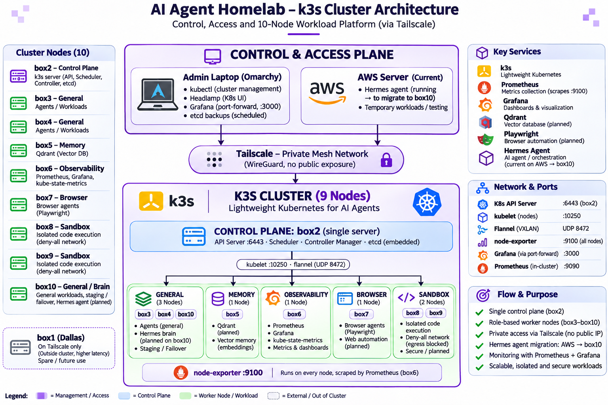
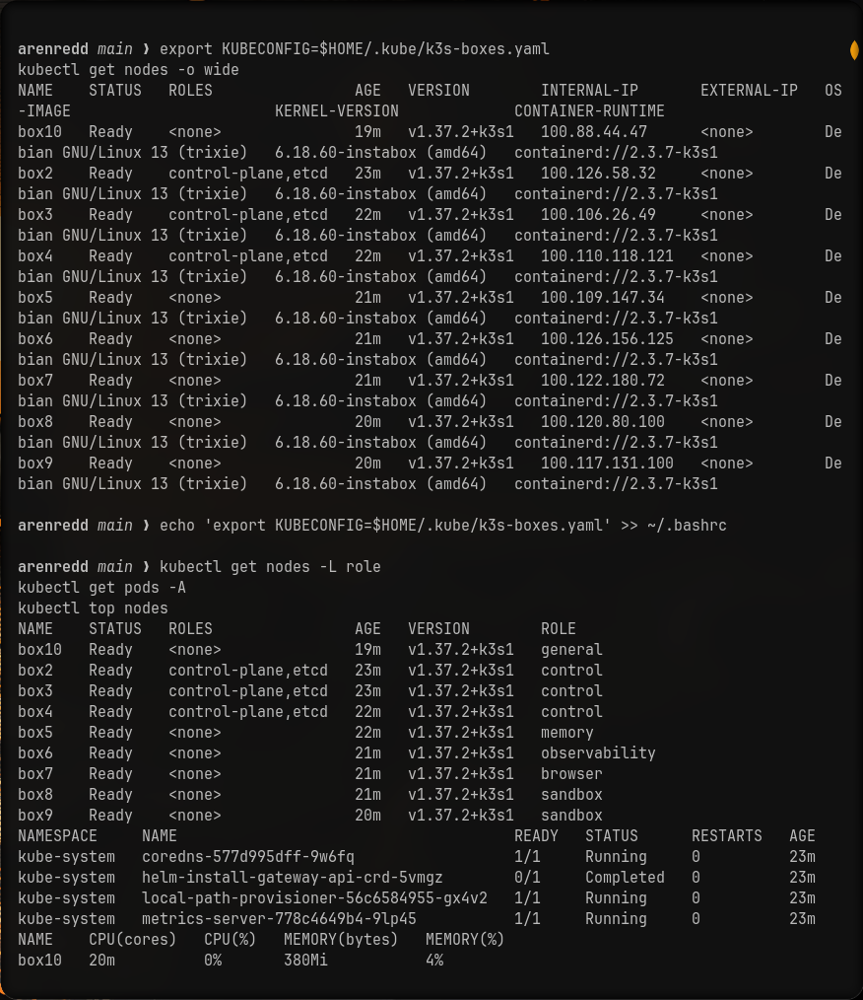
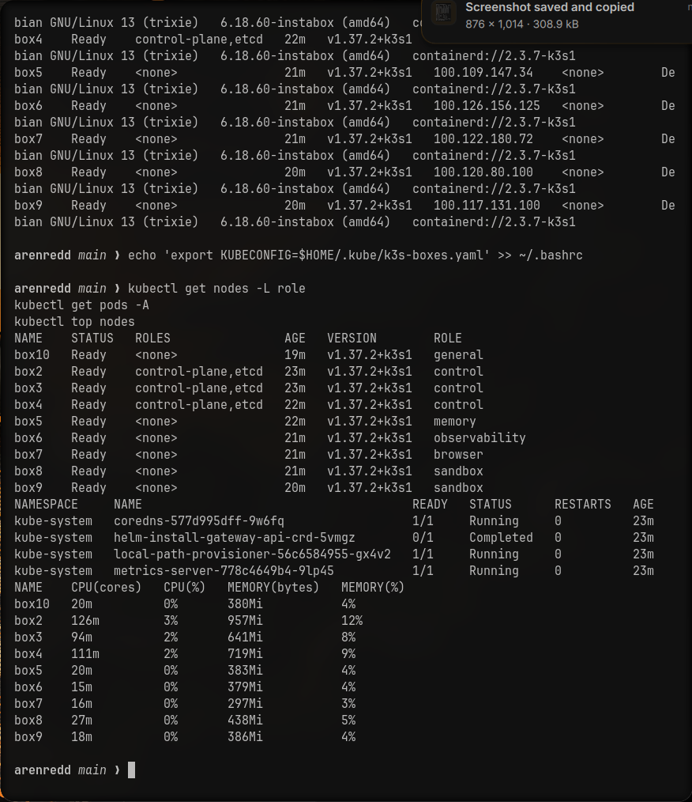
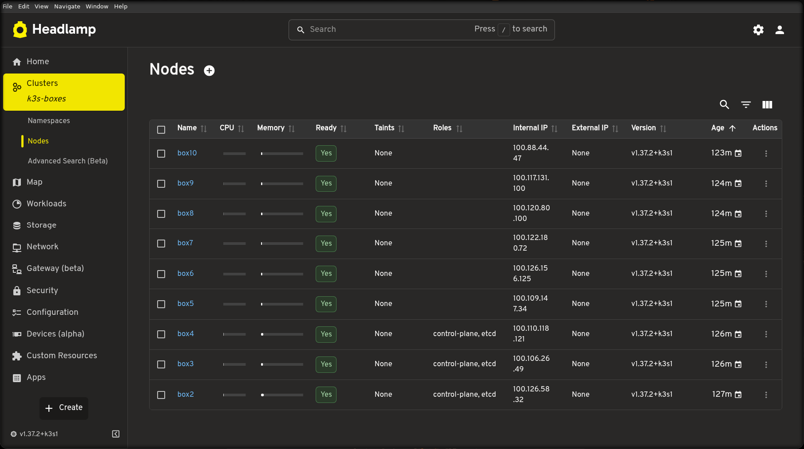
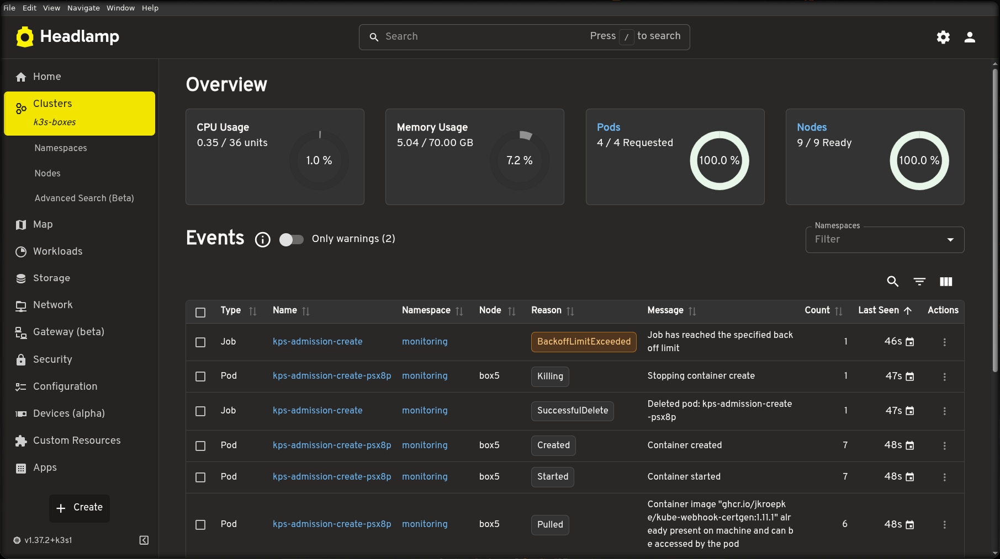

# k3s-ai-agent-platform

[](https://k3s.io)
[](https://tailscale.com)
[](https://prometheus.io)
[](https://grafana.com)
[](https://opensource.org/licenses/MIT)

## One-line description
A 10-node k3s cluster over Tailscale for running AI agents, with Prometheus/Grafana observability, role-based node pools and sandboxed execution.

## Overview
This project provisions a 10-node k3s cluster (1 control plane + 9 workers) using Tailscale as the private mesh network. The cluster runs on bare-metal/VM boxes with 4 CPU, ~8 GB RAM, and 16 GB disk each. Node1 (box1) in Dallas is excluded from the cluster; boxes 2-10 in the Seattle area form the k3s cluster.

The platform is designed for **sandboxed AI agent execution** with role-based node pools, observability via Prometheus + Grafana, and a strict security posture (Tailscale-only access, deny-all sandbox namespace). No agents are deployed yet — the platform is ready.

## Architecture
<details>
<summary>Text version of the architecture</summary>

```text
┌─────────────────────────────────────────────────────────────────┐
│  box1 (Dallas) — outside cluster, AWS/reachable via Tailscale │
│                                                                 │
│  box2 ───── control-plane ───── etcd ───── API Server          │
│  (role=general, control-plane, etcd)                          │
│                                                                 │
│  box3 ───── worker ───── role=general                         │
│  box4 ───── worker ───── role=general                         │
│  box5 ───── memory (Qdrant planned) ───── role=memory          │
│  box6 ───── observability ───── role=observability            │
│  │  Prometheus + Grafana + kube-state-metrics + operator      │
│  └─────────────────────────────────────────────────────────────┘
│                                                                 │
│  box7 ───── browser (planned) ───── role=browser               │
│  box8 ───── sandbox (deny-all) ───── role=sandbox              │
│  box9 ───── sandbox (planned) ───── role=sandbox               │
│  box10 ───── worker ───── role=general                        │
└─────────────────────────────────────────────────────────────────┘

Tailscale mesh: all boxes and laptop on private WireGuard.
Pod network: flannel CNI over Tailscale.
Service constraint: no ClusterIP Service with 2+ endpoints (use
replicas: 1 or headless Services). Kernel lacks random load
balancing, so 3-server HA was given up.
```
</details>


*Control plane on box2, 9 workers (box3-10), Tailscale mesh, role-based node pools, observability on box6.*

## Screenshots
| # | Screenshot | Caption |
|---|-----------|---------|
| 01 |  | Tailscale admin node mesh — all 10 boxes visible on the private network |
| 02 |  | kubectl nodes with roles assigned (general/observability/memory/sandbox) |
| 03 |  | Node roles, pod distribution, and top metrics overview |
| 04 |  | Tailscale "Connected machines" page — all 10 nodes online |
| 07 |  | Headlamp cluster overview — all nodes Ready |
| 08 |  | Headlamp — admission events and operator status |
| 11 |  | Grafana node-exporter dashboard — box3 metrics |
| 12 |  | Grafana K8s compute resources cluster dashboard |

*(Note: Screenshots 01 and 04 contain Tailscale network maps. Please review the sensitive-content check before including them. Screenshots 02-03, 07-08, 11-12 show kubectl/Headlamp/Grafana output and are safe to include.)*

## Cluster Layout Table

| Node | Role | Label | What Runs |
|------|------|-------|-----------|
| box2 | control-plane,etcd | `role=general,node-role.kubernetes.io/control-plane` | kube-apiserver, kube-scheduler, kube-controller-manager, etcd |
| box3 | worker | `role=general` | General agent workloads |
| box4 | worker | `role=general` | General agent workloads |
| box5 | memory (Qdrant planned) | `role=memory` | Qdrant vector store |
| box6 | observability | `role=observability` | Prometheus, Grafana, kube-state-metrics, operator |
| box7 | browser (planned) | `role=browser` | Browser-rendered agents |
| box8 | sandbox (deny-all) | `role=sandbox` | NetworkPolicy deny-all namespace |
| box9 | sandbox (planned) | `role=sandbox` | Sandboxed workloads |
| box10 | worker | `role=general` | General agent workloads |

## Key Design Decisions (Honest Trade-offs)

### Single Control Plane
The k3s cluster was reduced from 3 servers to 1 (box2) because the provider kernel lacks random IP load balancing, which breaks multi-endpoint ClusterIP Services. **This is a trade-off: HA was given up so that Services work correctly.**

### Tailscale-Only Networking
All boxes and the laptop are on Tailscale (private WireGuard mesh). The Kubernetes API server is not exposed publicly. No cloud load balancers, no external IPs.

### Service Constraint
No ClusterIP Service may have 2+ endpoints. Use `replicas: 1` or headless Services (`ClusterIP: None`). This is the primary networking constraint that drove the 3→1 server reduction.

### DNS for Internet-Having Pods
Pods needing internet access must set `dnsPolicy: None` with custom DNS servers `8.8.8.8` and `1.1.1.1` configured.

### Small Disk Management
All nodes have 16 GB disks. Weekly `crictl rmi --prune` is recommended to avoid filling the disk. No S3 storage — backups are stored on the laptop at `~/k3s-backups/`.

### Observability Stack
- Node-exporter on every node
- Prometheus + Grafana on box6 (`role=observability`)
- 3-day retention, 5 GB cap
- Grafana accessed via port-forward from laptop (Tailscale required)

## Quick Start

### Prerequisites
- Tailscale installed and running on all boxes and laptop
- k3s installed: single control plane on box2, workers box3-10
- `KUBECONFIG=~/.kube/k3s-boxes.yaml` set in environment

### Apply Manifests
```bash
git clone https://github.com/ArenRedd/k3s-ai-agent-platform.git
cd k3s-ai-agent-platform
kubectl apply -f manifests/
```

### Run the Example Agent Job
```bash
kubectl apply -f manifests/examples/agent-job.yaml
```
This Job uses `nodeSelector: role=general`, `dnsPolicy: None` with `8.8.8.8` and `1.1.1.1`, and resource limits appropriate for 16 GB disks.

### Access Grafana
```bash
# Port-forward (systemd user service handles auto-start)
systemctl --user start grafana-forward.service

# Open http://localhost:3000
# User: admin, Password: from ~/.k3s-cluster/grafana-pass
```

### Access Headlamp
```bash
# Walker launcher: SUPER + SPACE, type "K3s Dashboards"
# Or manually: flatpak run io.kinvolk.Headlamp --ozone-platform=x11
```

## Operations
See [docs/operations.md](docs/operations.md) for daily health checks, backup and restore, disk cleanup, and node maintenance.

## Security
See [docs/security.md](docs/security.md) for Tailscale-only access, deny-all sandbox, secrets handling, and kubeconfig risk.

## Status and Roadmap
- **Current status**: Platform is built and verified (Prometheus/Grafana installed, 9 nodes Ready, Service networking confirmed). **No agents are deployed yet.**
- **Roadmap**: See [docs/roadmap.md](docs/roadmap.md) for Qdrant, Hermes migration, browser agents, sandbox, 3-server HA restore, and Grafana alerts.

## License and Author
**MIT License** © 2026 **Anandram Mohan**

For questions, contact: arenredd@example.com

---
*This project was built by running exact commands in a documented operator runbook. No hype, no emojis beyond badges, and all design decisions are explicitly trade-offs.*
